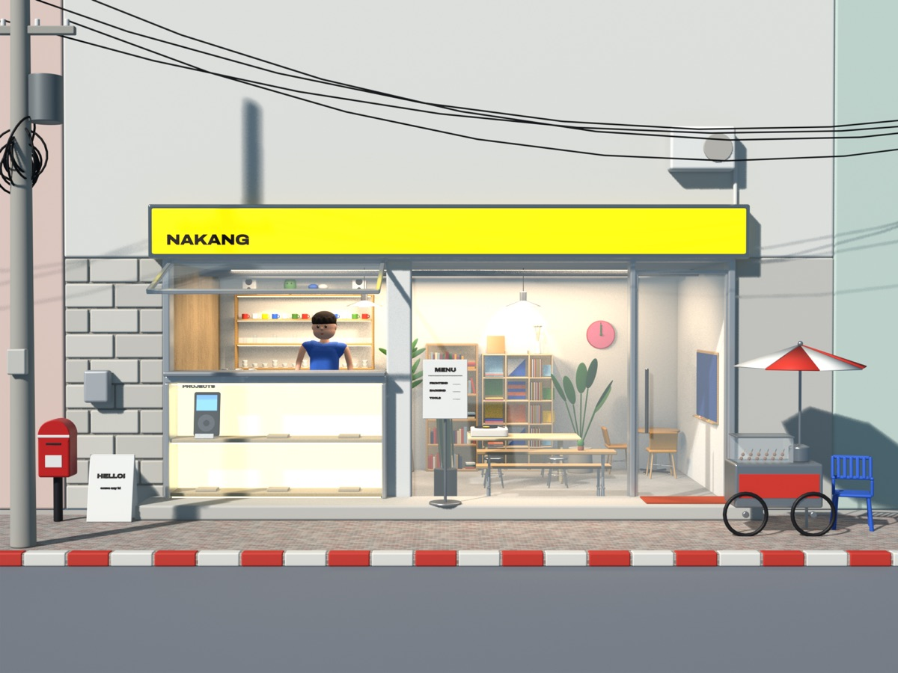

# NAKANG

A portfolio built as a tiny 3D Bangkok shop. You scroll to walk across the street up to the window, and you click things in the shop to learn about the work.

**Live:** https://portfolio-cafe-ten.vercel.app



## What you can do on the page

| Object | What it does |
|---|---|
| iPod in the PROJECTS case | Opens the iPort project |
| Person behind the counter | Waves hello and opens About |
| Menu stand | Skills, listed like a coffee menu |
| A-frame sign | A short hello |
| Record player | Lofi music on/off; the record spins while it plays |
| Door | Opens and closes; when it's open you can scroll on into the shop |
| Blue board | Opens a window for drawing a note, which then appears on the board |
| Wall clock | Shows the visitor's real time |
| Pendant lamps | Switch each light on/off |
| Red mailbox | Contact links |

The time of day follows the visitor's clock (add `?time=day`, `sunset` or `night` to the URL to force it). A three-step tour runs on the first visit; the **?** button opens it again.

## How it's built

```
blender/build_storefront.py   builds the whole scene in Blender from code (headless)
blender/export_web.py         exports web/storefront.glb (Draco) + web/rig.json
blender/export_mixamo.py      exports the character in an A-pose for Mixamo
mixamo/                       the Mixamo-rigged character with Waving and Breathing Idle clips
web/                          the static three.js page (no build step)
```

**Rebuild the model and the web files** (Blender 4.2 or newer):

```bash
/Applications/Blender.app/Contents/MacOS/Blender -b -P blender/build_storefront.py -- --time day --out out/storefront_day.blend --render out/day.png
```

```bash
/Applications/Blender.app/Contents/MacOS/Blender -b out/storefront_day.blend -P blender/export_web.py -- web
```

**Run the page locally:**

```bash
python3 -m http.server 5173 -d web
```

**Edit the text on the cards** in [web/content.js](web/content.js). More detail on the Blender side is in [blender/README.md](blender/README.md).

## Versioning and releases

Versions follow [Semantic Versioning](https://semver.org), read for a website:

- **Major**: the scene or the way you move through it changes in a big way.
- **Minor**: a new object, interaction or page feature.
- **Patch**: fixes, text and small visual tweaks.

Every release is listed in [CHANGELOG.md](CHANGELOG.md). To cut one:

1. Move the **Unreleased** notes in `CHANGELOG.md` under a new version heading with today's date.
2. Commit, then tag it: `git tag -a vX.Y.Z -m "vX.Y.Z"` and `git push --follow-tags`.
3. Deploy: `vercel deploy --prod` from `web/`.
4. Publish the GitHub release from the changelog notes: `gh release create vX.Y.Z --notes-file <notes>`.

## Credits

- Sign font: Archivo by Omnibus-Type, SIL Open Font License (`blender/fonts/OFL-Archivo.txt`).
- Character animation: Mixamo (Waving, Breathing Idle).
- 3D library: [three.js](https://threejs.org).
